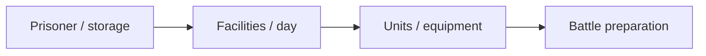

# DeathGuider — Team Contribution Portfolio

[English](README.md) · [Korean](README.ko.md) · [Japanese](README.ja.md)

**C# · Unity · O2CUBE** · 担当記録フォーク

[開発事例を見る](https://ysl-ryudo.github.io/ja/work/deathguider/) · [Portfolio](https://ysl-ryudo.github.io/ja/)

**O2CUBEチームプロジェクト**のポートフォリオ文書用フォークです。原本：[vliza321/DeathGuider](https://github.com/vliza321/DeathGuider)。元のリポジトリとクレジットを尊重し、**Young-Sang Lee（YSL-RyuDo）の担当範囲**を説明します。ゲーム全体の単独制作は主張しません。

原本mainが初期状態のため、このフォークのデフォルトは`0.23Ver`です。元のブランチと履歴を保持し、原本への変更・PRは送っていません。

## 取り組んだ課題

囚人の状態、施設、日付進行、戦闘準備を連携させる経営ゲームです。戦闘準備では空のパーティーによる入場を防ぐ必要があります。

## 担当した実装と設計

バス・囚人・保管管理、訓練・回復・侵食、研究所・鍛冶、戦闘準備時の人員・装備選択を担当しました。共同プロジェクト内の変更を本人作成コミットで示しています。

### 実装概要 · 概念フロー

### 開発デモ動画

- [DeathGuider demo](https://www.youtube.com/watch?v=dwgntWQCBTk)

撮影時点のプロジェクトデモです。ゲーム内での担当作業は以下の担当範囲で示します。

## 担当範囲：経営システム

- バス・囚人管理、一覧・保管、UIとデータの連携。
- 日付進行と経営状態の更新。
- 訓練・回復・侵食、研究所・鍛冶を含む施設関連システム。
- 戦闘準備：利用可能な人員・装備の選択、空パーティーでの入場防止、経営データと準備UIの接続。

本人のコミットと`Assets/Script/MainScene/`コードに基づく範囲です。戦闘AI、手続き型マップ、他のメンバーのシステムは担当範囲に含めません。

## Evidence / 근거 / 根拠

- [Management / 경영 / 経営](https://github.com/vliza321/DeathGuider/commit/ee560502e873a71a982aa4722c2f6e409fecadcc)
- [Research & smithing / 연구소·대장장이 / 研究所・鍛冶](https://github.com/vliza321/DeathGuider/commit/10e290b07c96a9d4d504f45d6329111dc779f1d2)
- [Battle preparation / 전투 준비 / 戦闘準備](https://github.com/vliza321/DeathGuider/commit/03e4576064a55a6fe22272c9d369c4f6e9c68eb6)
- [Empty-party guard / 빈 파티 방지 / 空パーティー防止](https://github.com/vliza321/DeathGuider/commit/5593c51c1824aed0503cf93ef2033e0e325a2e48)

## プロジェクトの確認

[ProjectVersion.txt](ProjectSettings/ProjectVersion.txt)のUnity版を使用してください。`0.23Ver`の経営シーンと`Assets/Script/MainScene/Lobby Test/`から確認できます。今回の文書作業は新たなビルド・プレイ検証ではありません。フォーク所有はチームのコード・素材の著作者や権利を移転するものではなく、元の履歴・クレジットを保持します。

## 実装の確認方法

0.23Verの4つの担当コミットとMainSceneの経営スクリプトから確認できます。戦闘AIと手続き型マップ生成は担当範囲に含めていません。
